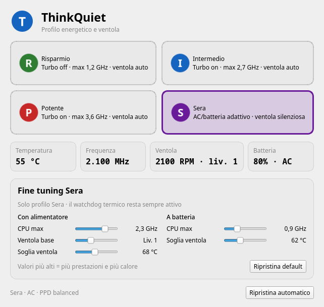

# ThinkQuiet

[English](README.md) | **Italiano**

**Profili energetici silenziosi e adattivi per ThinkPad T580 e serie simili.**



ThinkQuiet è un piccolo demone root con interfaccia PySide6 che unisce:

- profili CPU (`intel_pstate`: EPP, turbo, limite frequenza)
- controllo ventola ThinkPad (`thinkpad_acpi`, `/proc/acpi/ibm/fan`)
- cambio automatico batteria/alimentatore per il profilo **Sera**
- slider di fine tuning per Sera, applicati senza riavvii

Non è un controller ventola generico: è stato sviluppato e testato su un
**ThinkPad T580** e le soglie predefinite sono tarate su quella macchina.

> Non affiliato a Lenovo. “ThinkPad” è un marchio di Lenovo.

## Hardware testato

| Voce | Valore |
|---|---|
| Modello | ThinkPad T580 (20LAS3ME05) |
| CPU | Intel Core i5-8350U (4C/8T, 1,7–3,6 GHz) |
| BIOS | N27ET51W (1.37) |
| OS | CachyOS / Arch, KDE Plasma 6, Wayland |
| Ventola | `thinkpad_acpi`, `fan_control=1` |

Altri ThinkPad di 8ª generazione (T480, T490, X280, …) dovrebbero funzionare,
ma livelli ventola, soglie e comportamento EC possono variare. Apri una
segnalazione di compatibilità se ne provi uno.

## Funzioni

- **Quattro profili**: Risparmio, Intermedio, Potente, Sera.
- **Sera è adattivo**:
  - a batteria: ~0,9 GHz, turbo off, ventola **spenta**;
  - con alimentatore: ~2,0 GHz, turbo on, ventola **spenta** sotto la soglia
    (default 68 °C), poi rampa silenziosa del watchdog.
- **Fine tuning**: cinque slider per Sera (limiti CPU, ventola base, soglie
  termiche), applicati entro pochi secondi.
- **Watchdog termico**: la ventola sale automaticamente se la CPU si scalda,
  anche a GUI chiusa.
- **Sicuro in caso di crash**: `ExecStopPost` rimette la ventola in `auto` se il
  demone viene fermato, va in crash o viene ucciso.
- **Persistente**: ultimo profilo e tuning sopravvivono al riavvio.
- **Wayland-friendly**: la GUI gira come utente e comunica col demone tramite un
  file JSON; solo il cambio profilo usa una regola `sudo` ristretta.
- **Niente TLP/tuned**: `power-profiles-daemon` viene mantenuto allineato.

## Profili

| Profilo | Turbo | Limite CPU | EPP | Ventola | PPD |
|---|---|---|---|---|---|
| **Risparmio** | off | ~1,2 GHz | `power` | auto | `power-saver` |
| **Intermedio** | on | ~2,7 GHz | `balance_power` | auto | `balanced` |
| **Potente** | on | ~3,6 GHz | `performance` | auto | `performance` |
| **Sera (batteria)** | off | ~0,9 GHz | `power` | **spenta** | `power-saver` |
| **Sera (AC)** | on | ~2,0 GHz | `balance_power` | **spenta/silenziosa** | `balanced` |

Sera passa automaticamente da una variante all’altra quando colleghi/scolleghi
l’alimentatore (rilevato dal demone entro ~3 secondi).

### Ventola in Sera

**Batteria** (spenta di default):

- sotto 52 °C → spenta
- 62 °C → livello 1
- 70 °C → livello 3
- 78 °C → auto EC (mai rischiare la CPU)

**Alimentatore** (spenta di default, configurabile):

- sotto 68 °C → spenta
- 68 °C → livello 1
- 74 °C → livello 3
- 80 °C → auto EC

L’isteresi evita oscillazioni. Sul T580 il livello 0 è 0 RPM, il livello 1 è
circa 2100–2600 RPM, e l’auto EC era intorno a 3100 RPM a ~50 °C nei nostri test.

## Fine tuning

Quando è selezionato **Sera**, la GUI mostra il pannello “Fine tuning Sera”:

| Slider | Intervallo | Default |
|---|---|---|
| CPU max con alimentatore | 1,2–2,7 GHz | 2,0 GHz |
| Ventola base con alimentatore | Spenta – livello 3 | Spenta |
| Soglia ventola con alimentatore | 60–78 °C | 68 °C |
| CPU max a batteria | 0,6–1,7 GHz | 0,9 GHz |
| Soglia ventola a batteria | 55–75 °C | 62 °C |

Le soglie successive sono derivate automaticamente (+6/+12 °C su AC,
+8/+16 °C a batteria, con limiti di sicurezza). I valori sono salvati in
`/var/lib/thinkquiet/user/tuning.json`, scrivibile dall’utente desktop e letto
dal demone root. L’helper applica un clamp ai range sicuri.

## Requisiti

- Linux con systemd
- Python ≥ 3.10
- PySide6 (`pyside6` su Arch)
- `power-profiles-daemon`
- `thinkpad_acpi` con `fan_control=1`
- `sudo`, `visudo`
- Un ThinkPad la cui ventola risponda a `/proc/acpi/ibm/fan`

## Installazione

### Arch / CachyOS (testato)

```bash
git clone https://github.com/kkongiu/thinkquiet.git
cd thinkquiet
sudo ./install.sh
```

Se hai la versione pre-release `thinkpower`, l’installer migra profilo e tuning
e rimuove il vecchio servizio.

Riavvia se `fan_control` non è `Y`:

```bash
cat /sys/module/thinkpad_acpi/parameters/fan_control
```

Poi avvia **ThinkQuiet** dal menu applicazioni, oppure:

```bash
thinkquiet-gui
```

La GUI parte anche nel vassoio al login.

### Altre distribuzioni

L’installer è orientato ad Arch (`mkinitcpio`, `runuser`). Su altre distro:

1. Installa le dipendenze (`python3`, PySide6, power-profiles-daemon).
2. Copia `bin/thinkquiet` in `/usr/local/bin/` e `bin/thinkquiet-gui` in
   `~/.local/bin/`.
3. Installa `share/thinkquiet-daemon.service` in `/etc/systemd/system/`.
4. Aggiungi `options thinkpad_acpi fan_control=1` in `/etc/modprobe.d/` e
   aggiorna l’initramfs (`update-initramfs -u`, `dracut -f`, …).
5. Crea `/var/lib/thinkquiet/user/tuning.json` di proprietà del tuo utente.
6. Aggiungi la regola sudo da `install.sh` (o usa l’installer su Arch).

## Uso

- **Vassoio**: click sinistro apre/chiude la finestra; click destro seleziona il
  profilo.
- **Menu**: cerca “ThinkQuiet”.
- **Terminale**: `thinkquiet-gui` apre la finestra esistente se l’app è già in
  esecuzione (IPC a istanza singola).

### CLI

```bash
thinkquiet status
thinkquiet status --json
thinkquiet apply sera        # richiede sudo
thinkquiet apply intermedio
thinkquiet stop              # ripristina balanced + ventola auto
thinkquiet doctor
thinkquiet fan-auto          # comando di sicurezza, solo root
journalctl -u thinkquiet-daemon -f
```

La GUI applica i profili tramite una regola in `sudoers.d` limitata a
`thinkquiet apply <profilo>` e `thinkquiet stop`.

## Sicurezza

Il controllo manuale della ventola bypassa la politica termica del firmware.
ThinkQuiet lo mitiga con:

- watchdog termico nel demone root;
- `Restart=always` sul servizio systemd;
- `ExecStopPost=… fan-auto`, che ripristina il controllo EC anche dopo crash o
  SIGKILL;
- clamp dei valori di tuning;
- `auto` EC sopra la soglia più alta.

Usa comunque buon senso: non ostruire le prese d’aria, non usare “ventola
spenta” sotto carico pesante prolungato su superfici morbide, e controlla le
temperature con `thinkquiet status` o `sensors`.

Nessuna garanzia. Sei responsabile del tuo hardware.

## Compatibilità

- Testato principalmente su **ThinkPad T580 / i5-8350U**.
- I limiti fissi in MHz di Risparmio/Intermedio/Potente sono tarati per una CPU
  da 3,6 GHz. Su altri CPU, modifica le costanti in `bin/thinkquiet`.
- I limiti e le soglie di Sera sono configurabili dalla GUI.
- Il comportamento dei livelli `thinkpad_acpi` varia per modello. Il livello 0
  potrebbe non fermare la ventola su alcune macchine; il livello 1 può essere
  silenzioso o rumoroso a seconda dell’EC.

Se provi un altro modello, apri una issue con:

- modello e machine type (`sudo dmidecode -s system-version`)
- CPU e versione BIOS
- `cat /proc/acpi/ibm/fan`
- distro/desktop e versione kernel
- quali livelli ventola girano davvero e quanto sono rumorosi

## Risoluzione problemi

**`fan_control` è `N`**

```bash
cat /sys/module/thinkpad_acpi/parameters/fan_control
```

Assicurati che in `/etc/modprobe.d/` ci sia
`options thinkpad_acpi fan_control=1`, rigenera l’initramfs e riavvia.

**La GUI non si vede**

Controlla le icone nascoste del vassoio (`^`) o cerca “ThinkQuiet” nel menu.
Eseguire di nuovo `thinkquiet-gui` richiama la finestra esistente.

**Gli slider non persistono**

Controlla i permessi:

```bash
ls -l /var/lib/thinkquiet/user/tuning.json
```

Deve essere scrivibile dal tuo utente desktop. Se serve, riesegui
`sudo ./install.sh`.

**Conflitti con TLP/tuned**

Non usare TLP/tuned insieme a ThinkQuiet: entrambi scrivono EPP/turbo/limiti.
`power-profiles-daemon` è supportato e mantenuto allineato.

**Diagnostica**

```bash
thinkquiet doctor
thinkquiet status
journalctl -u thinkquiet-daemon -f
```

## Sviluppo

L’helper supporta un albero sysfs finto, quindi i test non toccano l’hardware:

```bash
python -m unittest discover -s tests -v
python -m py_compile bin/thinkquiet bin/thinkquiet-gui
bash -n install.sh uninstall.sh
```

Variabili utili:

- `THINKQUIET_ROOT` — radice filesystem finta
- `THINKQUIET_STATE_DIR` — stato runtime
- `THINKQUIET_LAST_DIR` — stato persistente
- `THINKQUIET_TUNING_FILE` — percorso tuning JSON
- `THINKQUIET_NO_PPD`, `THINKQUIET_NO_SYSTEMD` — disabilita chiamate esterne nei test
- `THINKQUIET_BIN` — percorso helper usato dalla GUI

Vedi `.github/workflows/ci.yml`.

## Packaging

Un template `PKGBUILD` è in `packaging/`. È un punto di partenza per un pacchetto
AUR: rivedi percorsi e regola sudoers prima di pubblicarlo.

## Disinstallazione

```bash
sudo ./uninstall.sh
```

Ferma il demone, ripristina balanced/ventola auto, rimuove helper, GUI, servizio,
regola sudo e opzione `fan_control` aggiunta da ThinkQuiet, e rigenera
l’initramfs. Riavvia per scaricare completamente il parametro del modulo.

## Progetti simili

ThinkQuiet punta sul **profilo silenzioso AC-aware**, non sull’ennesimo editor
di curve ventola. Progetti correlati:

- [thinkpad-fan-control](https://github.com/Swmarakis/thinkpad-fan-control)
- [curvy-tpfan](https://github.com/Ujang360/curvy-tpfan)
- [ThinkUtils](https://github.com/vietanhdev/ThinkUtils)
- [thinkfan](https://github.com/vmatare/thinkfan)
- [tpfanco](https://github.com/tpfanco/tpfanco)

## Licenza

MIT — vedi [LICENSE](LICENSE).
