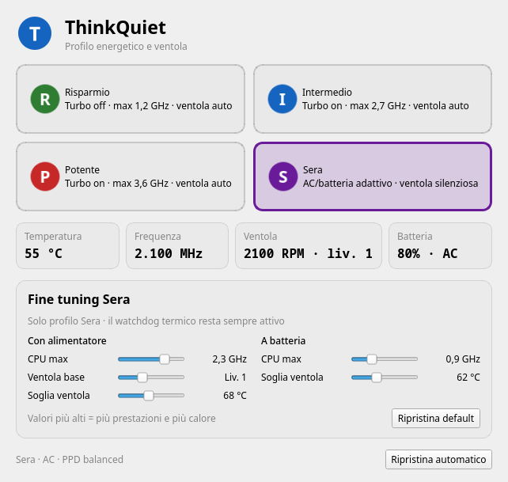

# ThinkQuiet

[](https://github.com/kkongiu/thinkquiet/actions/workflows/ci.yml)
[](LICENSE)

**Quiet, AC-aware power profiles for ThinkPad T580-class laptops.**



ThinkQuiet is a small root daemon plus a PySide6 tray application that combines:

- CPU power profiles (`intel_pstate`: EPP, turbo, frequency cap)
- ThinkPad fan control (`thinkpad_acpi`, `/proc/acpi/ibm/fan`)
- automatic battery/AC switching for the **Sera** (Evening) profile
- live sliders for fine-tuning Sera without restarting anything

It is **not** a general-purpose fan controller. It was built and tested on a
**ThinkPad T580**, and the default thresholds are tuned for that machine.

> Not affiliated with Lenovo. “ThinkPad” is a trademark of Lenovo.

## Tested hardware

| Item | Value |
|---|---|
| Model | ThinkPad T580 (20LAS3ME05) |
| CPU | Intel Core i5-8350U (4C/8T, 1.7–3.6 GHz) |
| BIOS | N27ET51W (1.37) |
| OS | CachyOS / Arch, KDE Plasma 6, Wayland |
| Fan | `thinkpad_acpi`, `fan_control=1` |

Other 8th-gen ThinkPads (T480, T490, X280, …) are likely to work, but their fan
levels, thresholds and EC behaviour may differ. Please open a compatibility
report if you test one.

## Features

- **Four profiles**: Risparmio, Intermedio, Potente, Sera.
- **Sera is AC-aware**:
  - on battery: ~0.9 GHz, turbo off, fan **off**;
  - with the charger: ~2.0 GHz, turbo on, fan **off** below the threshold
    (default 68 °C), then a quiet watchdog ramp.
- **Fine tuning**: five sliders for the Sera profile (CPU caps, fan base,
  temperature thresholds), applied live within a few seconds.
- **Thermal watchdog**: the fan is always ramped up automatically if the CPU
  gets hot, even when the GUI is closed.
- **Crash-safe**: `ExecStopPost` puts the fan back in `auto` if the daemon is
  stopped, crashes or is killed.
- **Persistent**: the last profile and the tuning survive reboots.
- **Wayland-friendly**: the GUI runs as your user and talks to the root daemon
  through a JSON tuning file; only profile changes use a narrow `sudo` rule.
- **No TLP/tuned required**: power-profiles-daemon is kept in sync.

## Profiles

| Profile | Turbo | CPU cap | EPP | Fan | PPD |
|---|---|---|---|---|---|
| **Risparmio** | off | ~1.2 GHz | `power` | auto | `power-saver` |
| **Intermedio** | on | ~2.7 GHz | `balance_power` | auto | `balanced` |
| **Potente** | on | ~3.6 GHz | `performance` | auto | `performance` |
| **Sera (battery)** | off | ~0.9 GHz | `power` | **off** | `power-saver` |
| **Sera (AC)** | on | ~2.0 GHz | `balance_power` | **off/quiet** | `balanced` |

Sera switches automatically between the two variants when you plug/unplug the
charger (detected by the daemon within ~3 seconds).

### Sera fan behaviour

**Battery** (fan off by default):

- below 52 °C → off
- 62 °C → level 1
- 70 °C → level 3
- 78 °C → EC auto (never risk the CPU)

**AC** (fan off by default, configurable):

- below 68 °C → off
- 68 °C → level 1
- 74 °C → level 3
- 80 °C → EC auto

Hysteresis prevents the fan from oscillating. On the T580, level 0 is 0 RPM,
level 1 is roughly 2100–2600 RPM, and EC auto was around 3100 RPM at ~50 °C in
our tests.

## Fine tuning

When **Sera** is selected, the GUI shows a “Fine tuning Sera” panel:

| Slider | Range | Default |
|---|---|---|
| CPU max with AC | 1.2–2.7 GHz | 2.0 GHz |
| Fan base with AC | Off – level 3 | Off |
| Fan threshold with AC | 60–78 °C | 68 °C |
| CPU max on battery | 0.6–1.7 GHz | 0.9 GHz |
| Fan threshold on battery | 55–75 °C | 62 °C |

The next thresholds are derived automatically (+6/+12 °C with AC, +8/+16 °C on
battery, capped for safety). Values are saved in
`/var/lib/thinkquiet/user/tuning.json`, which is writable by the desktop user
and read by the root daemon. All values are range-clamped by the helper.

## Requirements

- Linux with systemd
- Python ≥ 3.10
- PySide6 (`pyside6` on Arch)
- `power-profiles-daemon`
- `thinkpad_acpi` with `fan_control=1`
- `sudo`, `visudo`
- A ThinkPad whose fan responds to `/proc/acpi/ibm/fan`

## Install

### Arch / CachyOS (tested)

```bash
git clone https://github.com/kkongiu/thinkquiet.git
cd thinkquiet
sudo ./install.sh
```

If you have the pre-release `thinkpower` version installed, the installer
migrates the last profile and the tuning file and removes the old service.

Reboot if `/sys/module/thinkpad_acpi/parameters/fan_control` is not `Y`:

```bash
cat /sys/module/thinkpad_acpi/parameters/fan_control
```

Then launch **ThinkQuiet** from the application menu, or:

```bash
thinkquiet-gui
```

The GUI also starts in the system tray at login.

### Other distributions

The installer is Arch-oriented (`mkinitcpio`, `runuser`). On other distros:

1. Install dependencies (`python3`, PySide6, power-profiles-daemon).
2. Copy `bin/thinkquiet` to `/usr/local/bin/` and `bin/thinkquiet-gui` to
   `~/.local/bin/`.
3. Install `share/thinkquiet-daemon.service` in `/etc/systemd/system/`.
4. Add `options thinkpad_acpi fan_control=1` to `/etc/modprobe.d/` and update
   your initramfs (`update-initramfs -u`, `dracut -f`, …).
5. Create `/var/lib/thinkquiet/user/tuning.json` owned by your user.
6. Add the sudo rule from `install.sh` (or run the installer on Arch).

## Usage

- **Tray**: left click opens/closes the window; right click selects a profile.
- **Menu**: search “ThinkQuiet”.
- **Terminal**: `thinkquiet-gui` opens the existing window if the app is already
  running (single-instance IPC).

### CLI

```bash
thinkquiet status
thinkquiet status --json
thinkquiet apply sera        # requires sudo
thinkquiet apply intermedio
thinkquiet stop              # restore balanced + fan auto
thinkquiet doctor
thinkquiet fan-auto          # safety command, root only
journalctl -u thinkquiet-daemon -f
```

The GUI applies profiles through a `sudoers.d` rule limited to
`thinkquiet apply <profile>` and `thinkquiet stop`.

## Safety

Manual fan control bypasses the firmware’s thermal policy. ThinkQuiet mitigates
this with:

- a thermal watchdog in the root daemon;
- `Restart=always` on the systemd service;
- `ExecStopPost=… fan-auto`, which restores EC control even after a crash or
  SIGKILL;
- range-clamped tuning values;
- EC `auto` above the highest threshold.

Still, use common sense: do not block the vents, do not run “fan off” profiles
under sustained heavy load on soft surfaces, and monitor temperatures with
`thinkquiet status` or `sensors`.

This software comes with **no warranty**. You are responsible for your hardware.

## Compatibility

- Primarily tested on **ThinkPad T580 / i5-8350U**.
- The fixed MHz caps of Risparmio/Intermedio/Potente are tuned for a 3.6 GHz
  CPU. On other CPUs, adjust the profile constants in `bin/thinkquiet`.
- Sera limits and thresholds are configurable from the GUI.
- `thinkpad_acpi` fan level behaviour varies by model. Level 0 may not stop the
  fan on some machines; level 1 may be inaudible or loud depending on the EC.

If you test another model, please open an issue with:

- model and machine type (`sudo dmidecode -s system-version`)
- CPU and BIOS version
- `cat /proc/acpi/ibm/fan`
- distro/desktop and kernel version
- which fan levels actually spin and how loud they are

## Troubleshooting

**`fan_control` is `N`**

```bash
cat /sys/module/thinkpad_acpi/parameters/fan_control
```

Make sure `/etc/modprobe.d/` contains `options thinkpad_acpi fan_control=1`,
regenerate the initramfs and reboot.

**GUI not visible**

Check the hidden-icons area of the tray (`^`), or search “ThinkQuiet” in the
application menu. Running `thinkquiet-gui` again raises the existing window.

**Sliders do not persist**

Check ownership of the tuning directory:

```bash
ls -l /var/lib/thinkquiet/user/tuning.json
```

It must be writable by your desktop user. Re-run `sudo ./install.sh` if needed.

**Conflicts with TLP/tuned**

Do not run TLP/tuned and ThinkQuiet together: both write EPP/turbo/frequency
limits. power-profiles-daemon is supported and kept in sync.

**Diagnostics**

```bash
thinkquiet doctor
thinkquiet status
journalctl -u thinkquiet-daemon -f
```

## Development

The helper supports a fake sysfs root, so tests do not touch hardware:

```bash
python -m unittest discover -s tests -v
python -m py_compile bin/thinkquiet bin/thinkquiet-gui
bash -n install.sh uninstall.sh
```

Relevant environment variables:

- `THINKQUIET_ROOT` — fake filesystem root
- `THINKQUIET_STATE_DIR` — runtime state directory
- `THINKQUIET_LAST_DIR` — persistent state directory
- `THINKQUIET_TUNING_FILE` — tuning JSON path
- `THINKQUIET_NO_PPD`, `THINKQUIET_NO_SYSTEMD` — disable external calls in tests
- `THINKQUIET_BIN` — helper path used by the GUI

See `.github/workflows/ci.yml`.

## Packaging

A `PKGBUILD` template is in `packaging/`. It is intended as a starting point
for an AUR package; review paths and the sudoers setup before publishing.

## Uninstall

```bash
sudo ./uninstall.sh
```

This stops the daemon, restores balanced/fan auto, removes the helper, GUI,
service, sudoers rule and `fan_control` option added by ThinkQuiet, and rebuilds
the initramfs. Reboot to fully unload the module parameter.

## Prior art

ThinkQuiet focuses on the **AC-aware quiet profile** rather than being a generic
fan curve editor. Related projects worth knowing:

- [thinkpad-fan-control](https://github.com/Swmarakis/thinkpad-fan-control)
- [curvy-tpfan](https://github.com/Ujang360/curvy-tpfan)
- [ThinkUtils](https://github.com/vietanhdev/ThinkUtils)
- [thinkfan](https://github.com/vmatare/thinkfan)
- [tpfanco](https://github.com/tpfanco/tpfanco)

## License

MIT — see [LICENSE](LICENSE).
